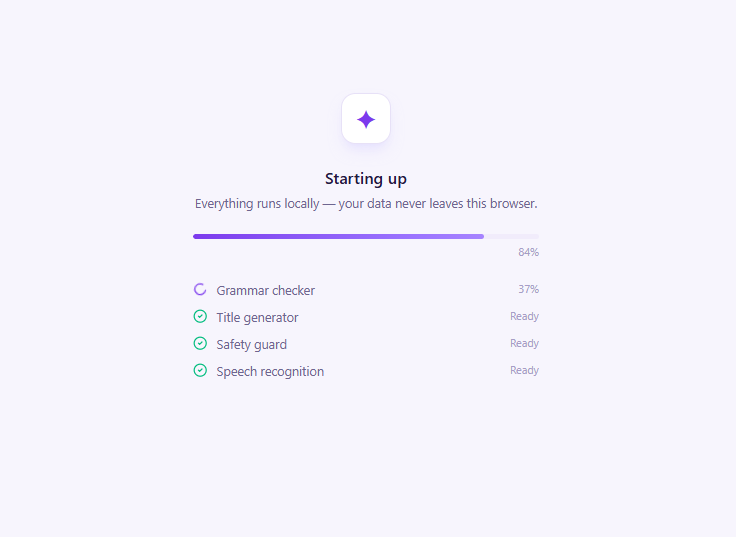
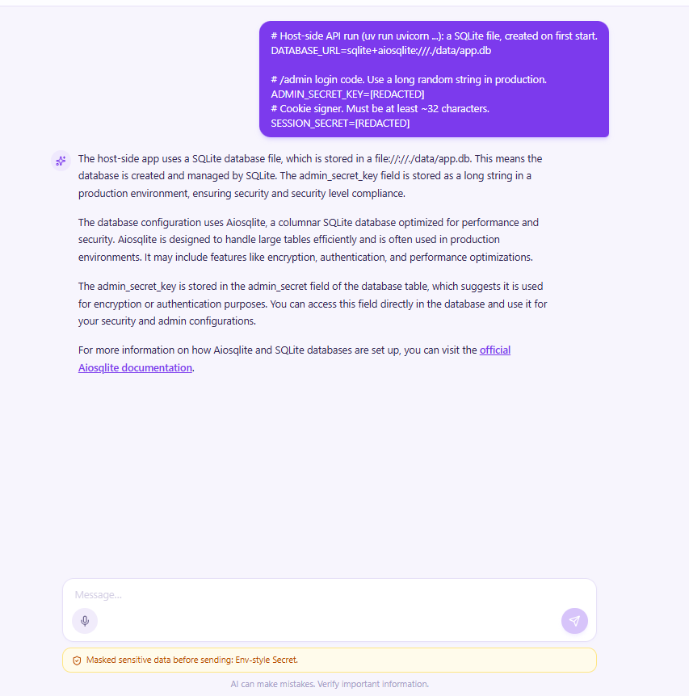
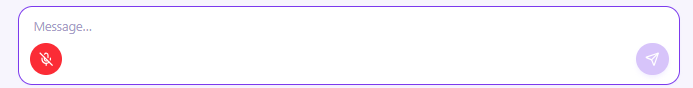

# Local LLM Chat with Voice Input

A Claude-style chat UI backed by a local LLM (Ollama) with in-browser speech recognition via Transformers.js (Whisper).

## Architecture

```
Local_LLM/
  frontend/   — React + TypeScript + Tailwind + Vite (port 5173)
  core/       — Node.js + Express HTTP API (port 3210)
```

The frontend is the only thing the user opens. `core/` is the backend.

## The app - Screenshots



## Features

- **Chat history sidebar** — conversations persisted in Postgres, listed like Claude
- **Streaming responses** — assistant tokens stream in real-time via Vercel AI SDK
- **Voice input** — mic button transcribes speech with Whisper (WebGPU or WASM) entirely in-browser; transcribed text is inserted into the composer for review before sending
- **Memory** — pgvector semantic memory + episodic message store across sessions
- **Web research** — orchestrator can delegate to a researcher sub-agent using Exa

## Screenshots

### Models load in the browser

On first load, the speech, grammar, title and safety-guard models download and run locally.


### Secret masking

The browser masks secrets before a message leaves it. The model and the server only see `[REDACTED]`, and a notice names what was masked.

![Sent message with ADMIN_SECRET_KEY and SESSION_SECRET replaced by [REDACTED]](docs/images/secret-masking-message.png)



### Voice input

The mic button turns red while recording. Click it again to transcribe into the composer.



## Run with Docker

One command starts everything: Postgres with pgvector, Ollama, the API, and the UI behind nginx.

```bash
cp .env.example .env    # set EXA_API_KEY at minimum
docker compose up --build
```

Open http://localhost:8080 (change with `WEB_PORT`). The first start pulls the Ollama chat and embedding models, so it can take several minutes. The API only starts once the pull finishes.

nginx serves the UI and proxies `/api/` to `core`, so the browser calls one origin. It also sets the COOP and COEP headers that Whisper's WASM threading needs. Postgres data and Ollama models live in the `pgdata` and `ollama` volumes. `docker compose down -v` deletes them.

Without Docker, use the setup below.

## Prerequisites

- Node.js 22+
- Ollama running locally with the configured models
- PostgreSQL with pgvector
- Exa API key
- Chromium-based browser (Chrome 113+ for WebGPU; falls back to WASM on others)

## Setup

### 1. Backend (`core/`)

```bash
cd core
cp .env.example .env   # fill in DATABASE_URL, EXA_API_KEY, OLLAMA_* vars
npm install
npm run db:migrate
npm run dev            # starts Express API on http://localhost:3210
```

See [core/README.md](./core/README.md) for API details, architecture, and known limitations.

### 2. Frontend (`frontend/`)

```bash
cd frontend
npm install
npm run dev            # starts Vite on http://localhost:5173
```

Open http://localhost:5173 in your browser.

## Environment Variables (`core/.env`)

| Variable | Default | Description |
|----------|---------|-------------|
| `DATABASE_URL` | required | Postgres connection string |
| `EXA_API_KEY` | required | Exa web search API key |
| `OLLAMA_BASE_URL` | `http://localhost:11434` | Ollama host |
| `OLLAMA_MODEL` | `erwan2/DeepSeek-R1-Distill-Qwen-1.5B` | Chat model |
| `OLLAMA_EMBED_MODEL` | `nomic-embed-text` | Embedding model |
| `PORT` | `3210` | HTTP server port |
| `CORS_ORIGIN` | `http://localhost:5173` | Allowed CORS origin |

## Voice Input

On first load, the Whisper model (~80 MB WASM / ~160 MB WebGPU) downloads from Hugging Face and is cached in the browser. After that, it loads instantly.

### Using a different Whisper model

The default is `onnx-community/whisper-base.en` from the Hub. To use another model, set these in `frontend/.env` (dev) or the root `.env` (Docker):

| Variable | Default | Description |
|----------|---------|-------------|
| `VITE_ASR_MODEL_ID` | `onnx-community/whisper-base.en` | Hub model id, or a folder name under `frontend/public/models/` |
| `VITE_ASR_LOCAL_MODELS` | `false` | Set `true` to load `VITE_ASR_MODEL_ID` from `/models/<id>` |

A local model needs the transformers.js ONNX layout (`config.json`, `onnx/encoder_model_*.onnx`, `onnx/decoder_model_merged_*.onnx`, tokenizer files). The worker requests `fp16` files on WebGPU and `q8` files on WASM. Vite inlines these values at build time, so rebuild the frontend image after changing them.

The fine-tuning pipeline that produced `whisper-base-en-ewc-v1` lives in its own repo and is not part of this one.

Click the mic button in the composer to start recording. Click again to stop. The transcribed text is placed in the text box for you to edit before sending.
